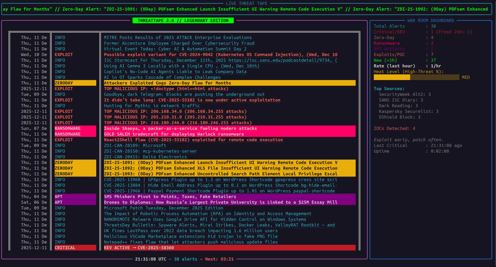
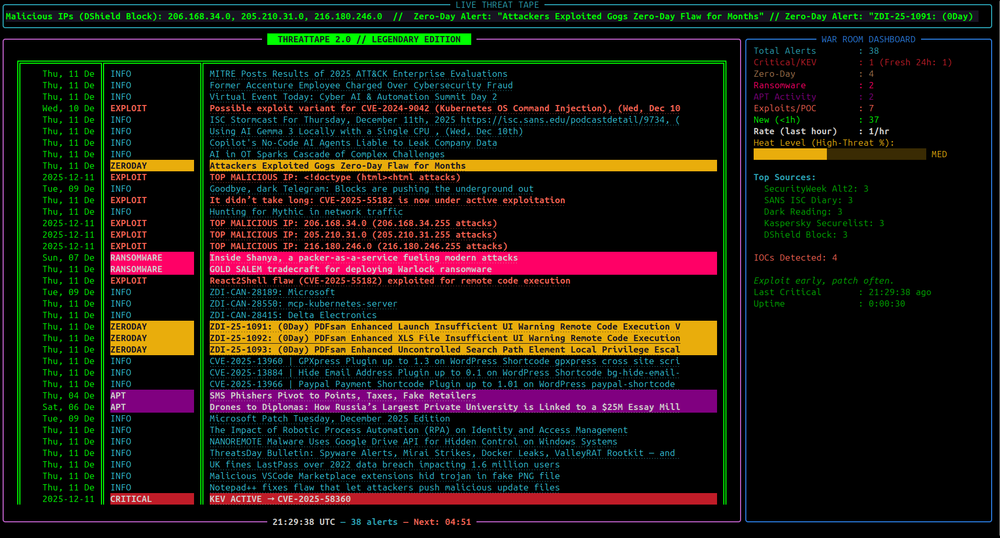
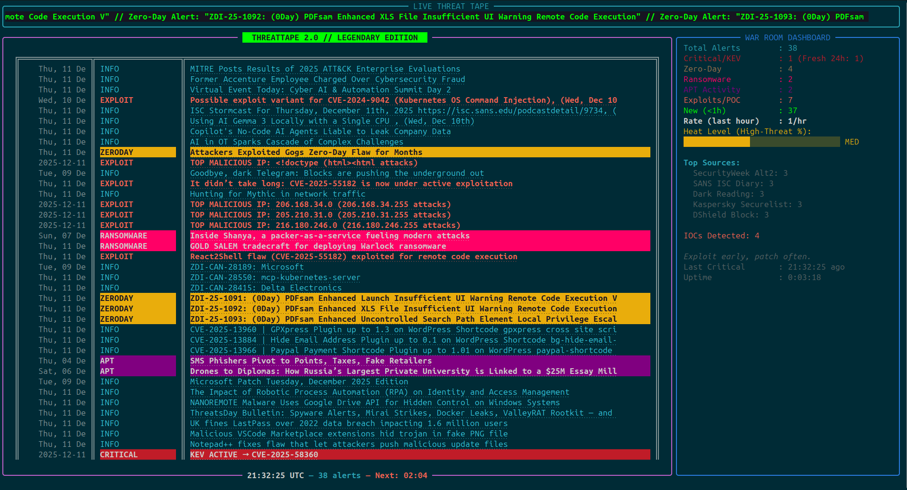
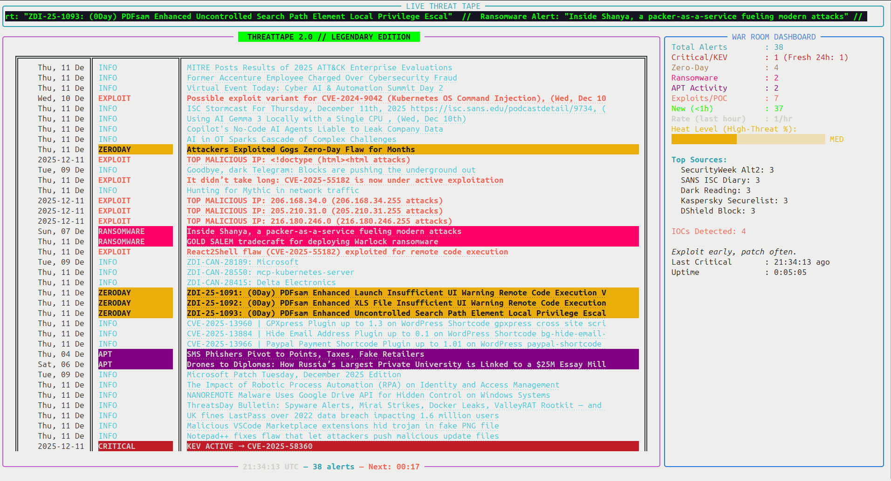

# ThreatTape 2.0 // Legendary Edition 🟢

[](https://www.python.org/)
[](https://opensource.org/licenses/MIT)
[](https://github.com/Textualize/rich)

**A real-time cyber threat intelligence dashboard in your terminal.**

ThreatTape pulls the latest alerts from top security sources (CISA KEV, The Hacker News, Krebs, BleepingComputer, ZDI, Kaspersky, VulDB, and many more), classifies them by severity, and displays them in a continuously updating, color-rich TUI built with **[Rich](https://github.com/Textualize/rich)**.

It’s designed for security analysts, red teamers, blue teamers, and anyone who wants to keep an eye on the threat landscape without leaving the terminal.

## Features

- **Live scrolling ticker** with zero-day alerts, ransomware activity, and top malicious IPs
- **Color-coded severity tagging** (Critical/KEV, Zero-Day, Ransomware, APT, Exploit)
- **Real-time metrics dashboard** (threat heat level, alert rates, top sources, trend graph)
- **Audible + visual alerts** on fresh critical/zero-day events
- **Customizable recency window** (24h / 48h / 7 days) – press `1`, `2`, or `3` anytime
- **Manual refresh** with `R`
- **Seamless scrolling ticker** and flashing border on high-impact events
- **No external dependencies** beyond standard Python libraries + `rich`, `httpx`, and `feedparser`

## Screenshots

### GNOME Dark Theme


### Green/Black High Contrast


### Solarized Dark


### Solarized Light


## Installation & Usage

```bash
# Clone the repo
git clone https://github.com/yourusername/threattape.git
cd threattape

# Recommended: create a virtual environment
python3 -m venv venv
source venv/bin/activate

# Install dependencies
pip install rich httpx feedparser

# Run it!
python threattape.py