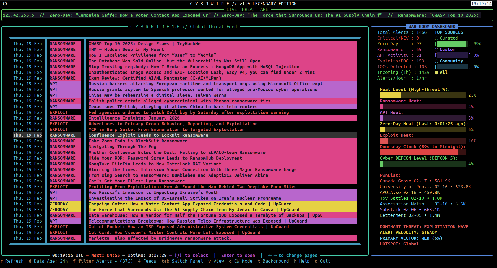
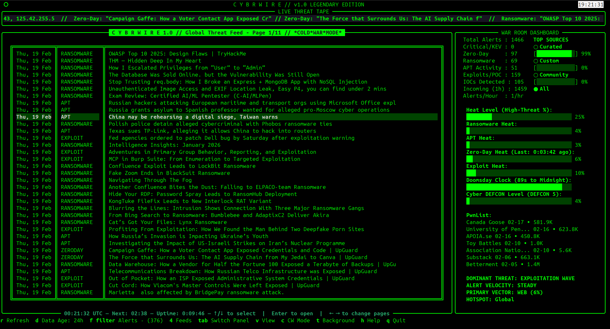
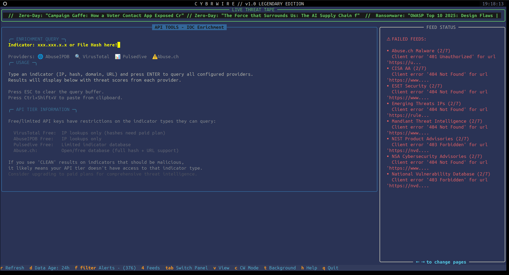
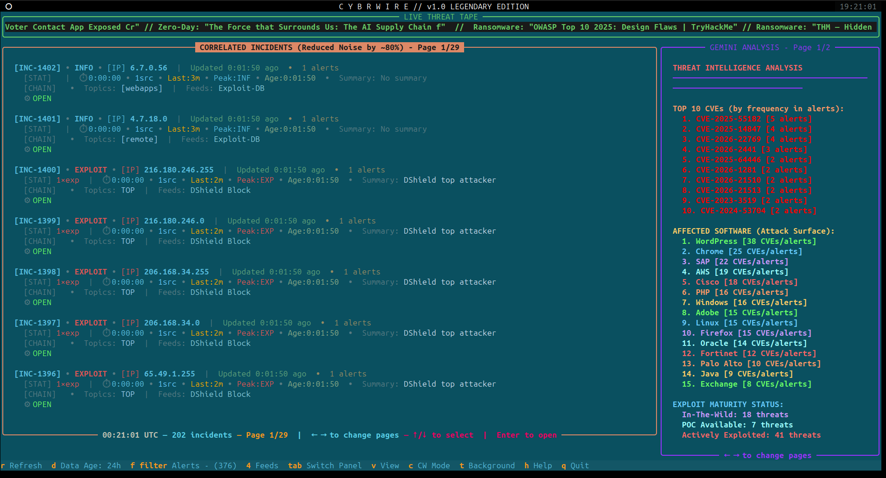
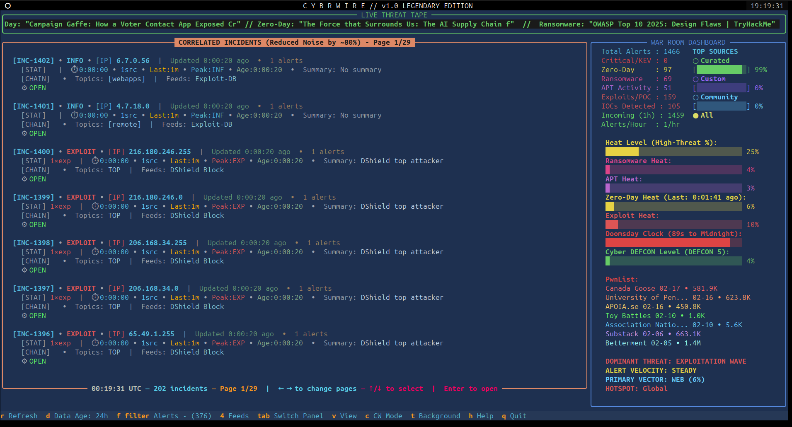

# C Y B R W I R E // Legendary Edition

[](https://www.python.org/)
[](https://opensource.org/licenses/MIT)
[](https://github.com/Textualize/rich)
[](https://github.com/Textualize/textual)

**A real-time cyber threat intelligence dashboard in your terminal.**

CYBRWIRE pulls the latest alerts from dozens of top security sources (CISA KEV, The Hacker News, Krebs, BleepingComputer, ZDI, Kaspersky, VulDB, and many more), classifies them by severity, and displays them in a continuously updating, color-rich TUI built with **[Textual](https://github.com/Textualize/textual)** and **[Rich](https://github.com/Textualize/rich)**.

CYBRWIRE also includes tools (via api keys) to identify malicious IPs and query databases for malicous file hashes.

More than just a glorified feed-reader, CYBRWIRE is designed for security analysts, red teamers, blue teamers, and anyone who wants to keep an eye on the threat landscape without leaving the terminal.

## Features

- **75+ curated threat intelligence sources** including CISA, SANS, Microsoft, Cisco Talos, Kaspersky, Unit 42, Ransomware.live, and more
- **Multi-format feed support** – JSON, RSS, and plain text feeds
- **Configurable feeds** – define curated, custom, and community intelligence sources via YAML
- **Real-time threat enrichment** – Integrate with VirusTotal, AbuseIPDB, Pulsedive, and Abuse.ch APIs
- **AI threat briefings with your choice of provider** – Claude, Gemini, OpenAI, OpenRouter, Ollama (local), or any OpenAI-compatible server
- **Alert preview and AI explanations** – read the summary of the selected alert without leaving the terminal, or press `a` for an AI explanation
- **NEW badges** – alerts first seen since your last launch stay marked until you open them
- **Color-coded severity tagging** (Critical/KEV, Zero-Day, Ransomware, APT, Exploit)
- **Real-time metrics dashboard** with threat heat level, alert rates, top sources, and incident correlation
- **Live scrolling ticker** displaying latest threats and alerts
- **Multiple theme support** – cycle through GNOME Dark, Green/Black High Contrast, Solarized Dark, and more
- **Cold War Mode** – authentic green-on-black terminal aesthetic for when you're feeling like it's 1985
- **Customizable recency window** (24h / 48h / 7 days)
- **Advanced filtering** – view alerts only, incidents, or API enrichment tools
- **Interactive browsing** – open threat sources in your default browser
- **Incident correlation** – automatically group related threats by CVE, IP, hash, and domain
- **Manual refresh** with keyboard controls and feed pagination
- **Saved settings** – theme, filters and display mode persist between runs
- **Minimal dependencies** – runs with `rich`, `httpx`, `feedparser`, `pyyaml`, `textual`, and `anthropic` (only needed for Claude)

## Screenshots

### Main Dashboard - Black Theme


### Cold War Mode (Classic Green Terminal)


### Alert View


### Incident Correlation


### API Tools & Enrichment


## Installation & Usage

```bash
# Clone the repo
git clone https://github.com/QIO1984/cybrwire.git
cd cybrwire

# Recommended: create a virtual environment
python3 -m venv venv
source venv/bin/activate

# Install dependencies
pip install -r requirements.txt

# Configure API keys (optional, for enrichment features)
cp usrwire.yaml cybrwire_local.yaml
# Edit cybrwire_local.yaml and add your API keys

# Run it!
python3 cybrwire.py
```

### Keyboard Controls

| Key | Action |
|-----|--------|
| `h` | Show help screen |
| `r` | Force refresh all feeds |
| `d` | Cycle data age (24h → 48h → 7d) |
| `f` | Cycle filter (all → alerts only → posts only) |
| `4` | Cycle threat feed source (all → curated → custom → community) |
| `tab` | Switch between main feed and dashboard panels |
| `v` | Cycle main view (alerts → incidents → API tools) |
| `c` | Toggle Cold War Mode |
| `t` | Cycle theme |
| `↑` `↓` / click | Select an alert or incident (click again to open) |
| `enter` | Open the selected alert or incident in your browser |
| `a` | Explain the selected alert with AI |
| `g` | Generate a fresh AI briefing (War Room) |
| `e` | Re-enable disabled feeds |
| `q` | Quit |

Your data age, display mode, theme and filters are saved in `cybrwire_state.json`, so later launches skip the startup questions. Run `python3 cybrwire.py --setup` to answer them again.

## AI Briefings

The War Room panel (`tab`, then `v`, or just press `g`) shows a briefing written by the AI provider you choose: bottom line, priority actions, active threats, notable vulnerabilities, and a watch list, based on the alerts in your current data window. Press `a` on any alert for a short explanation of it.

Configure one provider in `cybrwire_local.yaml`:

```yaml
ai:
  provider: "anthropic"    # anthropic | gemini | openai | openrouter | ollama | openai_compatible
  api_key: "your-key"      # not needed for ollama
  model: ""                # blank = provider default (anthropic: claude-opus-5-5, gemini: gemini-flash-latest)
  base_url: ""             # only for ollama / openai_compatible
```

OpenAI, OpenRouter, Ollama, and OpenAI-compatible servers need `model` set. Ollama runs models on your own machine, so no alert data leaves it. One provider is active at a time; `usrwire.yaml` has a commented example for each.

## API Key Enrichment

CybrWire supports optional threat intelligence API enrichment. Configure API keys in `cybrwire_local.yaml`:

```yaml
enrichment:
  virustotal_api_key: "your-vt-api-key-here"
  abuseipdb_api_key: "your-abuseipdb-api-key-here"
  pulsedive_api_key: "your-pulsedive-api-key-here"
  abuse_ch_api_key: "your-abuse-ch-api-key-here"
```

**Note:** API keys in `cybrwire_local.yaml` are in `.gitignore` and will never be committed to GitHub.

## API Tier Limitations ⚠️

CybrWire supports multiple threat intelligence providers with optional API key enrichment. **Free and limited API tiers have restrictions on indicator types they can query.**

### VirusTotal
- **Free Tier**: IPs, file hashes, domains, and URLs
  - Rate limit: 4 queries/minute, 500/day quota
- **Paid Tier**: Higher quotas and premium features

### AbuseIPDB
- **Free Tier**: IP reputation lookups only
  - Limited to IP addresses (no hashes, domains, URLs)
- **Paid Tier**: Enhanced features and higher rate limits
- **When to upgrade**: For broader query quotas and advanced scoring

### Pulsedive
- **Free Tier**: Limited indicator database
  - May not have comprehensive hash or malware data
- **Paid Tier**: Full threat intelligence database access
- **When to upgrade**: For comprehensive threat data across all indicator types

### Abuse.ch
- **Free**: MalwareBazaar (hashes) and URLhaus (URLs, IPs, domains)
  - Requires a free Auth-Key from https://auth.abuse.ch/
- **Recommended for**: Hash and malicious URL lookups

### Recommendation

For best results with CybrWire enrichment:
1. **Use Abuse.ch** (free Auth-Key) for hash and URL enrichment
2. **Use AbuseIPDB** for IP reputation (free tier available)
3. **Use VirusTotal** for multi-engine verdicts on any indicator type
4. **Configure multiple providers** for redundancy and broader coverage

A **CLEAN** result means the provider has no record of the indicator, not that it is known to be safe.

## Configuration Files

- **`cybrwire.yaml`** – Curated official threat feeds (CISA, Microsoft, Talos, etc.)
- **`usrwire.yaml`** – Template for your own API keys and custom feeds
- **`comwire.yaml`** – Community-contributed feeds - Submit yours via PR
- **`cybrwire_local.yaml`** – Your private API keys and feeds (in .gitignore)

Feeds can be `rss`, `json` (CISA KEV, Ransomware.live, and AlienVault OTX formats), or `txt`
(IP/CIDR lists, URL lists, DShield, and URLhaus CSV). Feeds that need an API key can send it
as a header instead of putting it in the URL:

```yaml
custom:
  - name: "AlienVault OTX - Subscribed Pulses"
    url: "https://otx.alienvault.com/api/v1/pulses/subscribed?limit=10"
    type: "json"
    headers:
      X-OTX-API-KEY: "your-otx-key"
```

Errors and feed failures are written to `cybrwire.log` in the app folder.

## Features in Detail

### War Room (AI Analysis)
An AI briefing (see [AI Briefings](#ai-briefings)) followed by a local keyword analysis that needs no AI: top CVEs, affected software, exploit maturity, sectors, and threat actors.

### Incident Correlation
An incident is created when independent sources point at the same thing:
- The same **CVE**, **IP address**, or **file hash** reported by two or more different feeds
- A named **threat actor or ransomware group** appearing in two or more alerts

Each incident explains itself: what it is (the CISA KEV description when the CVE is known exploited), why the alerts were grouped, when it was first and last reported and by whom, related incidents, and the latest reports.

### Dashboard
Metrics are computed from the alerts in your data window. The ransomware hotspot and most active group come from Ransomware.live victim posts, alert velocity compares the last 24 hours with the 24 hours before, and the Doomsday Clock shows the [Bulletin of the Atomic Scientists](https://thebulletin.org/doomsday-clock/) setting, checked once a day.

### API Tools
Query threat intelligence APIs directly from CybrWire:
- Enter an indicator (IP, hash, domain, or URL)
- Get reputation scores and threat details from all configured providers
- See which APIs support which indicator types

## Requirements

- Python 3.10+
- `rich` – Beautiful terminal output
- `httpx` – Async HTTP client for feed fetching
- `feedparser` – RSS/Atom feed parsing
- `pyyaml` – YAML configuration files
- `textual` – TUI framework
- `anthropic` – Only used when the AI provider is `anthropic`

## License

MIT License - See LICENSE file for details

## Contributing / Feed Crowd-sourcing

Contributions are welcome and much needed! Please feel free to submit pull requests or open issues for bugs and feature requests.

If you have a cool source for intel, please submit it via PR to the comwire.yaml 
Verified feeds will be added to the canon.

## Author

By: GitHub/QIO1984 // The Hacker known as MADNOTE


---

**Stay vigilant. Stay informed. CYBRWIRE**
