# C Y B R W I R E // Legendary Edition

**A real-time cyber threat intelligence dashboard in your terminal.**

CYBRWIRE pulls the latest alerts from dozens of top security sources (CISA KEV, The Hacker News, Krebs, BleepingComputer, ZDI, Kaspersky, VulDB, and many more), classifies them by severity, and displays them in a continuously updating, color-rich TUI built with **[Textual](https://github.com/Textualize/textual)** and **[Rich](https://github.com/Textualize/rich)**.

CYBRWIRE also includes tools (via api keys) to identify malicious IPs and query databases for malicious file hashes.

More than just a glorified feed-reader, CYBRWIRE is designed for security analysts, red teamers, blue teamers, and anyone who wants to keep an eye on the threat landscape without leaving the terminal.

## Features

- **100+ curated threat intelligence sources** including CISA, vendor advisories (Fortinet, Palo Alto, Cisco, Ivanti, Microsoft), national CERTs, GitHub security advisories, Ransomware.live, ThreatFox, and more
- **Grouped by what you need** – press `4` to switch between Advisories (what to patch), News & Research, Ransomware, Indicators (what to block), and Outages (what is broken right now)
- **CVE scores** – CISA KEV status, CVSS severity (NVD) and EPSS exploit likelihood shown wherever a CVE appears
- **Watchlist** – star everything that mentions the vendors, products or keywords you care about, and press `w` to see only those
- **Search** – press `/` to filter as you type across all feeds and a year of saved history, including older alerts and indicators
- **Duplicate grouping** – the same story from several feeds becomes one row marked `+N`; `u` lists every report
- **Notifications** – push watchlist hits, new KEV entries or zero-days to ntfy, Pushover, Telegram, Discord or Slack
- **Digest mode** – `cybrwire --digest` prints a plain-text summary for a terminal, pipe or cron job, with no AI calls
- **CVE card** – press `i` for CVSS, EPSS, CISA KEV status, exploit links, affected products and which of your feeds report it
- **Multi-format feed support** – JSON, RSS, and plain text feeds
- **Configurable feeds** – define curated, custom, and community intelligence sources via YAML
- **Real-time threat enrichment** – Integrate with VirusTotal, AbuseIPDB, Pulsedive, and Abuse.ch APIs
- **AI threat briefings with your choice of provider** – Claude, Gemini, OpenAI, OpenRouter, Ollama (local), or any OpenAI-compatible server
- **Alert preview and AI explanations** – read the summary of the selected alert without leaving the terminal, or press `a` for an AI explanation
- **NEW badges** – alerts first seen since your last launch stay marked until you open them
- **Color-coded severity tagging** (Critical/KEV, Zero-Day, Ransomware, APT, Exploit)
- **Real-time metrics dashboard** with threat heat level, alert rates, top sources, and incident correlation
- **Threat map** – the opening view: a world map in braille dots with pulsing markers for ransomware victims, attributed nation-state activity, national advisories and active outages, with the latest strong alerts and an activity scope underneath; `m` opens it full window
- **Atmosphere** – a radar sweep over the map and a window-edge pulse (plus a FLASH banner in Cold War mode) when something urgent arrives; `x` switches it off
- **Live Wire** across the top: real feed checks as they run, new alerts as they arrive, and the most severe current items between them
- **Themes** – Neon Noir (default: near-black with vivid pink, cyan, blue and violet), Synthwave, Retro Warm and Amber CRT; press `t` to cycle
- **Cold War Mode** – a green phosphor terminal with military message precedence, Zulu timestamps and a classification banner, for when you're feeling like it's 1985
- **Customizable recency window** (24h / 48h / 7 days)
- **Advanced filtering** – view alerts only, incidents, or API enrichment tools
- **Interactive browsing** – open threat sources in your default browser
- **Incident correlation** – automatically group related threats by CVE, IP, hash, and domain
- **Manual refresh** with keyboard controls and feed pagination
- **Saved settings** – theme, filters and display mode persist between runs
- **Minimal dependencies** – runs with `rich`, `httpx`, `feedparser`, `pyyaml`, `textual`, and `anthropic` (only needed for Claude)

## Screenshots

### Main Dashboard (Synthwave, the default theme)
The live threat feed with a preview of the selected alert, and the dashboard: severity counts, heat meters, threat insights, 24-hour activity and the most-reported CVEs.

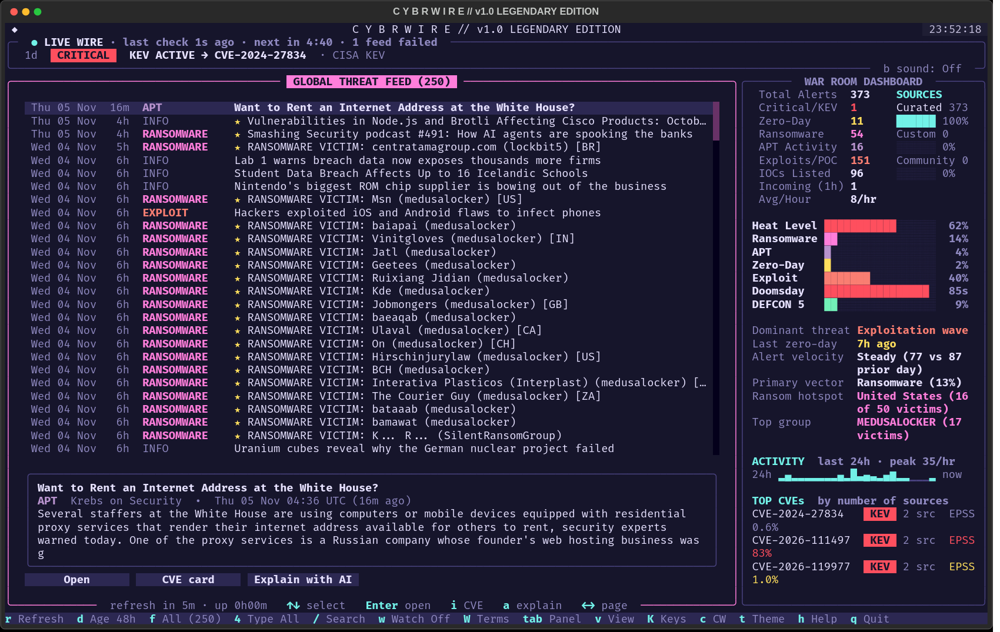

### Search (Amber CRT)
Press `/` to search every loaded feed and a year of history as you type. Search ignores the Data Age window.

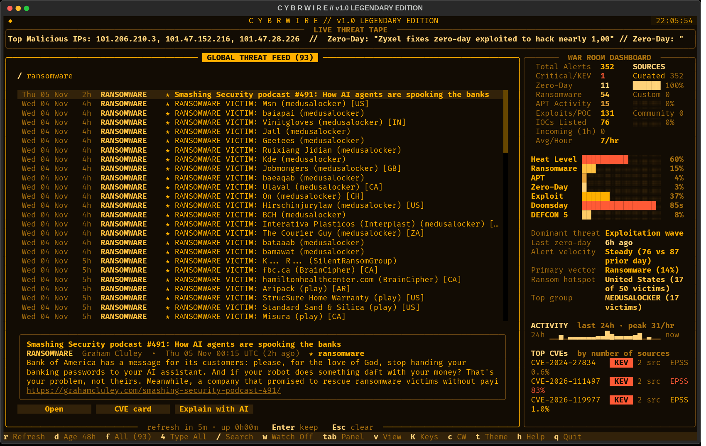

### Watchlist (Retro Warm, Synthwave)
Star the vendors and products you care about, then press `w` to see only those. `Shift+W` lists every term and what it catches.

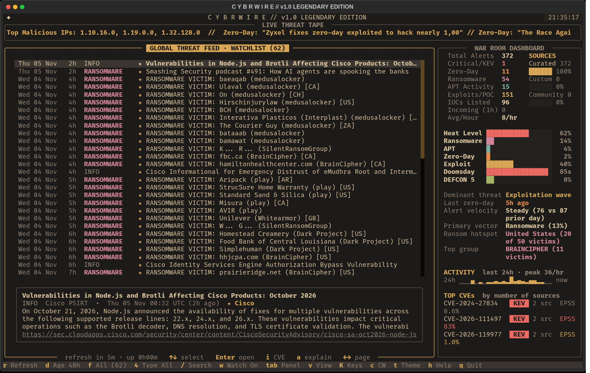

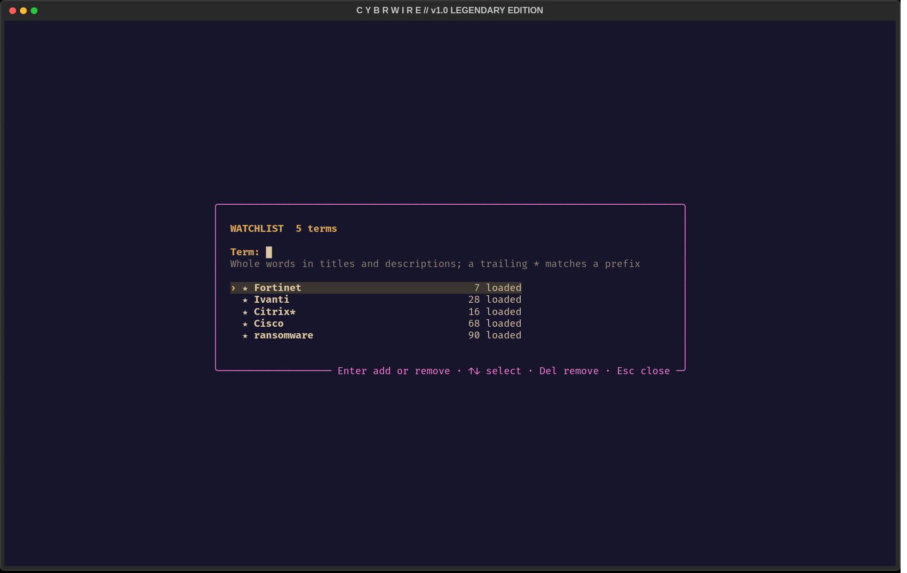

### CVE Card (Amber CRT)
Press `i` on any alert for severity, EPSS, known exploitation, CISA's required action, affected products and references.

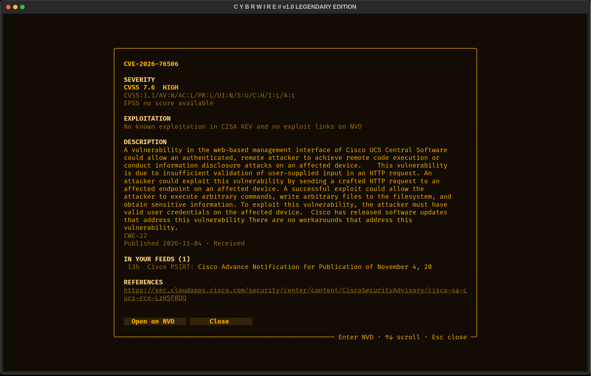

### Grouped Duplicates (Amber CRT)
The same story from several feeds becomes one row marked `+N`. Press `u` to list every report.

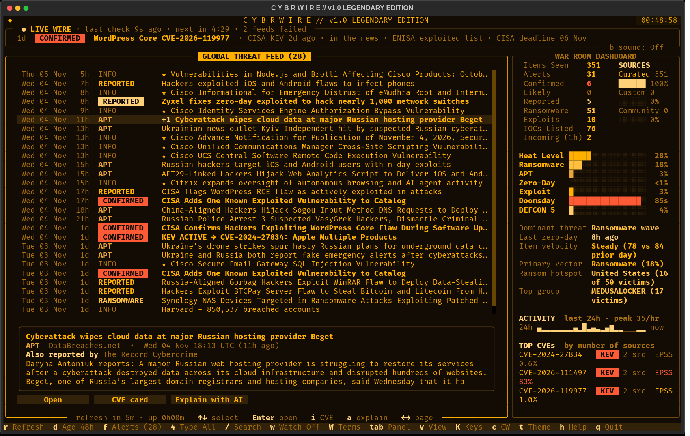

### Live Wire (Retro Warm)
The bar across the top follows each feed check as it runs and announces what's new. Between arrivals, the most severe current items take turns.

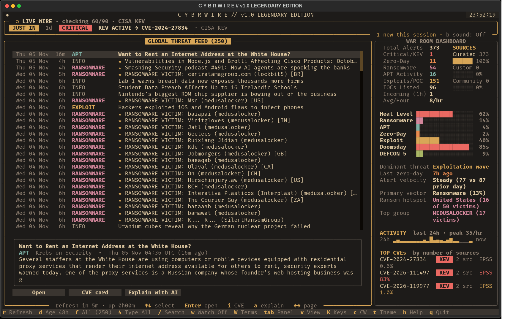

### API Keys (Synthwave)
Press `Shift+K` to enter and test keys. They go to your system keychain and never appear in full.

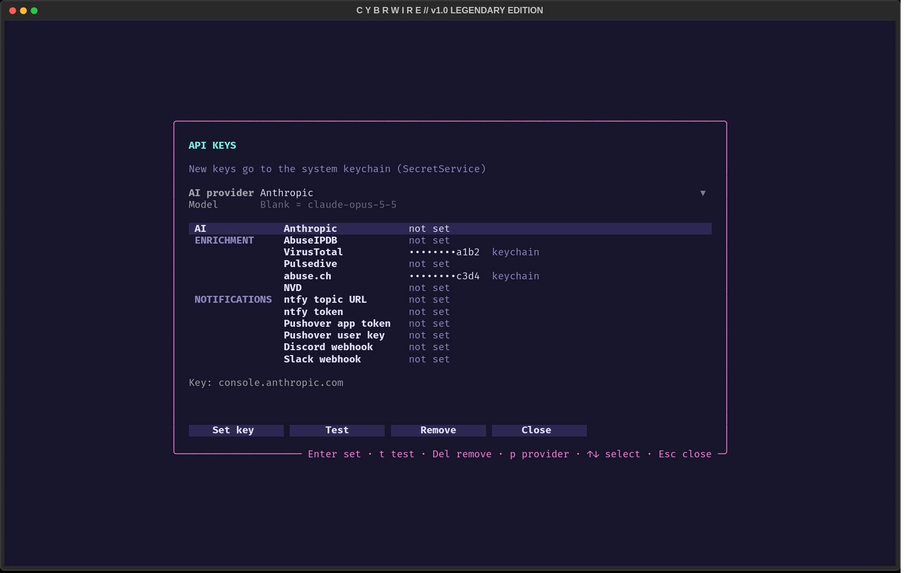

### Indicators (Retro Warm)
Malicious IPs, URLs and C2 servers get their own view. Press `Enter` on one to look it up in IOC Lookup.

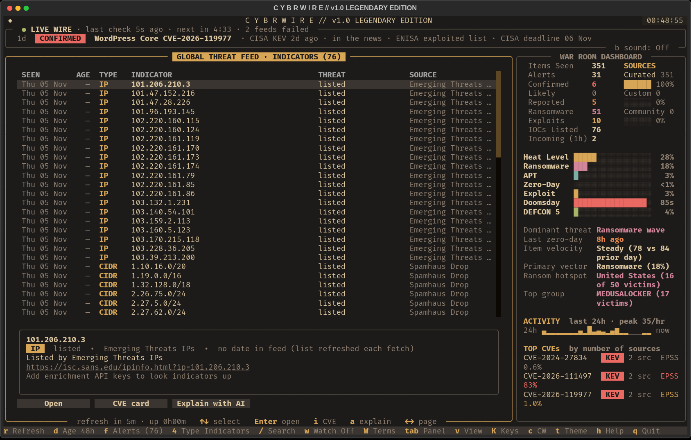

### Incidents and War Room
Alerts correlated into incidents when independent sources report the same CVE, IP, hash or threat actor, next to an AI briefing in the War Room.

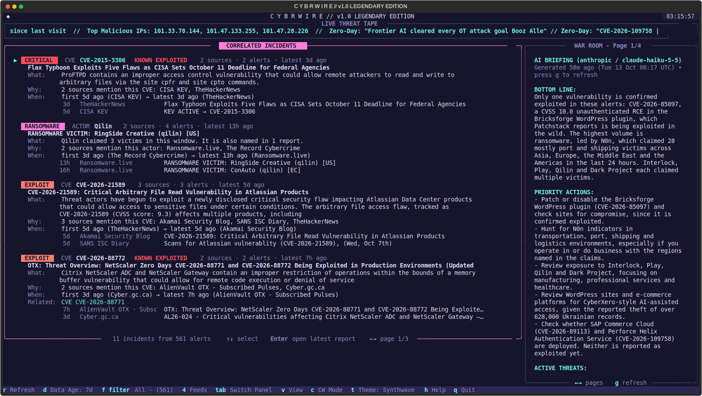

### Cold War Mode
A green phosphor terminal: FLASH / IMMEDIATE / PRIORITY / ROUTINE message precedence, Zulu date-time groups, a classification banner and a teletype cursor. Press `c` to toggle.

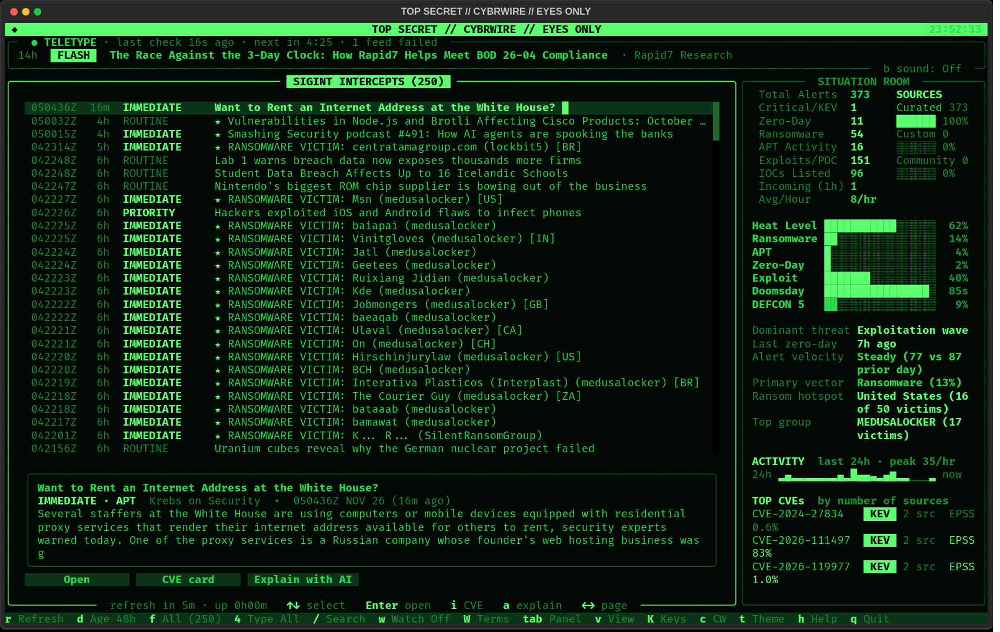

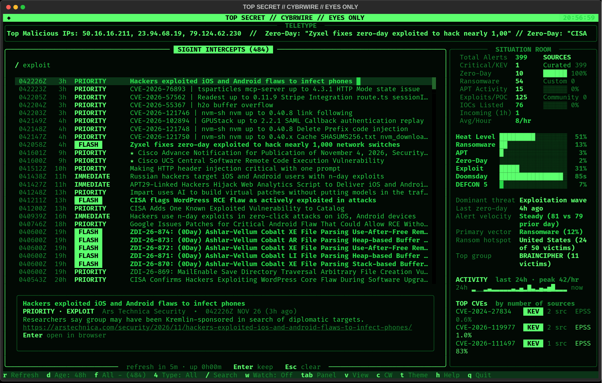

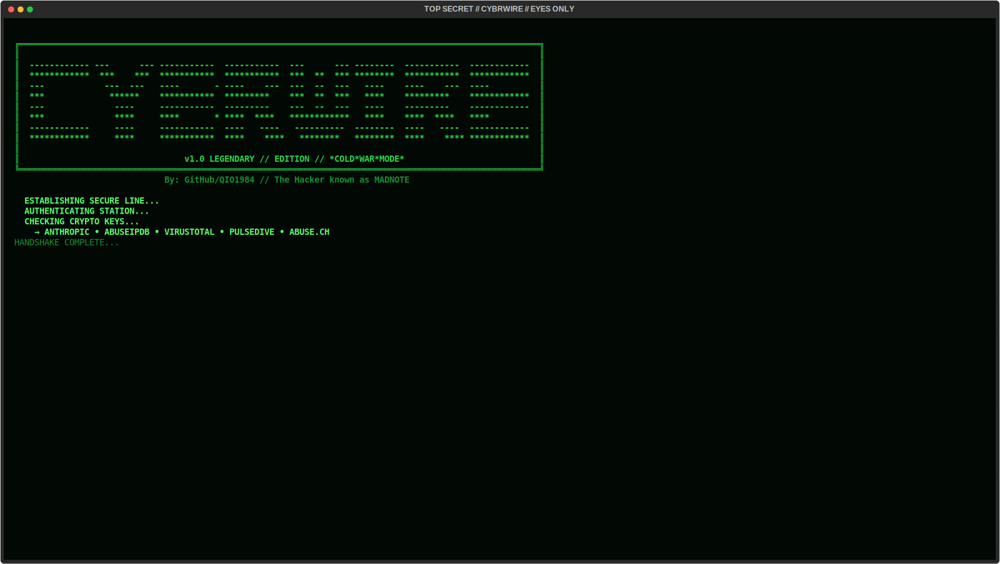

### IOC Lookup (API Tools)
Press `v` until you reach IOC Lookup. It looks up an IP address, file hash, domain or URL across every provider you have a key for, and shows one answer.

- **Nothing to type?** The page opens on a short list to try: your recent lookups first, then the freshest indicators from your feeds (ThreatFox, URLhaus and the like). Pick one with `↑↓` and press `Enter`, or click it.
- **Paste anything.** Defanged indicators from reports work as they are: `hxxps://evil[.]com/x` is looked up as `https://evil.com/x`, and the page says how it was typed. A label beside the box names what it thinks you pasted (IPv4, IPv6, MD5, SHA-1, SHA-256, SHA-512, domain or URL).
- **Providers at a glance.** A line shows which providers are on, which have no key yet, and which cannot answer the kind of indicator you typed (AbuseIPDB handles IP addresses only).
- **One verdict, then the detail.** The worst level any provider reports, how many providers flag it as malicious, then a row per provider with a score bar and the few facts worth reading (country, ISP, report counts, malicious vendors, malware family and so on).
- **Esc** goes back to the suggestions for a new lookup. A CLEAN result means a provider has no record of the indicator, not that it is safe.

## Requirements

- Python 3.10+
- `rich` – Beautiful terminal output
- `httpx` – Async HTTP client for feed fetching
- `feedparser` – RSS/Atom feed parsing
- `pyyaml` – YAML configuration files
- `textual` – TUI framework
- `anthropic` – Only used when the AI provider is `anthropic`
- `tzdata` – Time zone names for the world clock
- `textual-serve` – Only for the browser and Docker version (the `web` extra)

## Data Sources and Credits

CybrWire is MIT licensed, but the data it reads belongs to the people who publish it. Thank you to all of them. Nothing is redistributed: your copy fetches each source itself, and shows headlines, short summaries and links back to the original.

| Source | What it gives CybrWire | Terms to know |
|---|---|---|
| [NVD](https://nvd.nist.gov) (NIST) | CVSS scores and descriptions | *This product uses the NVD API but is not endorsed or certified by the NVD.* |
| [FIRST EPSS](https://www.first.org/epss) | Exploit likelihood | Free; FIRST asks for credit where possible: *See EPSS at https://www.first.org/epss* |
| [CISA KEV](https://www.cisa.gov/known-exploited-vulnerabilities-catalog) | Known exploited vulnerabilities | US government data |
| [ENISA EUVD](https://euvd.enisa.europa.eu) | Exploited vulnerabilities (EU) | |
| [CIRCL Vulnerability-Lookup](https://vulnerability.circl.lu) | Exploitation sightings | See the Evidence section |
| [Metasploit Framework](https://github.com/rapid7/metasploit-framework) (Rapid7) | Public exploit modules | BSD 3-Clause |
| [Spamhaus DROP](https://www.spamhaus.org/drop/) | Hijacked network ranges | Credit to The Spamhaus Project; CybrWire fetches it every 6 hours (they ask for no more than hourly) |
| [DShield / SANS ISC](https://isc.sans.edu) | Attacking and blocked IPs | CC BY-NC-SA 4.0: credit, non-commercial, don't resell the data |
| [Have I Been Pwned](https://haveibeenpwned.com) | Recent data breaches | CC BY 4.0: data from haveibeenpwned.com |
| [Ransomware.live](https://www.ransomware.live) | Ransomware victim claims | The free v2 API is for personal use; see their API PRO for business use |
| [Natural Earth](https://www.naturalearthdata.com) | Land outlines for the threat map (110m, baked into the app as a small dot grid) | Public domain |
| [Bulletin of the Atomic Scientists](https://thebulletin.org/doomsday-clock/) | The Doomsday Clock setting | |

The remaining sources are public blogs, advisories and news feeds. Please visit the originals and support them.

**Using CybrWire at work?** Some free feeds limit business use (Ransomware.live's free API, DShield's non-commercial licence). Read each provider's terms, and remove or replace a feed in your own copy if it doesn't allow your use.

## License

MIT License - See LICENSE file for details

## Contributing / Feed Crowd-sourcing

Contributions are welcome and much needed! Please feel free to submit pull requests or open issues for bugs and feature requests.

If you have a cool source for intel, please submit it via PR to the community.yaml 
Verified feeds will be added to the canon.

## Author

By: GitHub/QIO1984 // The Hacker known as MADNOTE

---

**Stay vigilant. Stay informed. Stay WIREed**
