# C Y B R W I R E // Legendary Edition

[](https://www.python.org/)
[](https://opensource.org/licenses/MIT)
[](https://github.com/Textualize/rich)
[](https://github.com/Textualize/textual)

**A real-time cyber threat intelligence dashboard in your terminal.**

CYBRWIRE pulls the latest alerts from dozens of top security sources (CISA KEV, The Hacker News, Krebs, BleepingComputer, ZDI, Kaspersky, VulDB, and many more), classifies them by severity, and displays them in a continuously updating, color-rich TUI built with **[Textual](https://github.com/Textualize/textual)** and **[Rich](https://github.com/Textualize/rich)**.

CYBRWIRE also includes tools (via api keys) to identify malicious IPs and query databases for malicous file hashes.

More than just a glorified feed-reader, CYBRWIRE is designed for security analysts, red teamers, blue teamers, and anyone who wants to keep an eye on the threat landscape without leaving the terminal.

## Features

- **85+ curated threat intelligence sources** including CISA, vendor advisories (Fortinet, Palo Alto, Cisco, Ivanti, Microsoft), national CERTs, GitHub security advisories, Ransomware.live, ThreatFox, and more
- **Grouped by what you need** – press `4` to switch between Advisories (what to patch), News & Research, Ransomware, and Indicators (what to block)
- **CVE scores** – CISA KEV status, CVSS severity (NVD) and EPSS exploit likelihood shown wherever a CVE appears
- **Watchlist** – star everything that mentions the vendors, products or keywords you care about, and press `w` to see only those
- **Search** – press `/` to filter as you type across all feeds and a year of saved history, including older alerts and indicators
- **Duplicate grouping** – the same story from several feeds becomes one row marked `+N`; `u` lists every report
- **Notifications** – push watchlist hits, new KEV entries or zero-days to ntfy, Discord or Slack
- **Digest mode** – `python3 cybrwire.py --digest` prints a plain-text summary for a terminal, pipe or cron job, with no AI calls
- **CVE card** – press `i` for CVSS, EPSS, CISA KEV status, exploit links, affected products and which of your feeds report it
- **Multi-format feed support** – JSON, RSS, and plain text feeds
- **Configurable feeds** – define curated, custom, and community intelligence sources via YAML
- **Real-time threat enrichment** – Integrate with VirusTotal, AbuseIPDB, Pulsedive, and Abuse.ch APIs
- **AI threat briefings with your choice of provider** – Claude, Gemini, OpenAI, OpenRouter, Ollama (local), or any OpenAI-compatible server
- **Alert preview and AI explanations** – read the summary of the selected alert without leaving the terminal, or press `a` for an AI explanation
- **NEW badges** – alerts first seen since your last launch stay marked until you open them
- **Color-coded severity tagging** (Critical/KEV, Zero-Day, Ransomware, APT, Exploit)
- **Real-time metrics dashboard** with threat heat level, alert rates, top sources, and incident correlation
- **Live Wire** across the top: real feed checks as they run, new alerts as they arrive, and the most severe current items between them
- **Retro themes** – Synthwave (default), Retro Warm and Amber CRT; press `t` to cycle
- **Cold War Mode** – a green phosphor terminal with military message precedence, Zulu timestamps and a classification banner, for when you're feeling like it's 1985
- **Customizable recency window** (24h / 48h / 7 days)
- **Advanced filtering** – view alerts only, incidents, or API enrichment tools
- **Interactive browsing** – open threat sources in your default browser
- **Incident correlation** – automatically group related threats by CVE, IP, hash, and domain
- **Manual refresh** with keyboard controls and feed pagination
- **Saved settings** – theme, filters and display mode persist between runs
- **Minimal dependencies** – runs with `rich`, `httpx`, `feedparser`, `pyyaml`, `textual`, and `anthropic` (only needed for Claude)

## Screenshots

### Main Dashboard (Synthwave, the default theme)
The live threat feed with a preview of the selected alert, and the dashboard: severity counts, heat meters, threat insights, 24-hour activity and the most-reported CVEs.

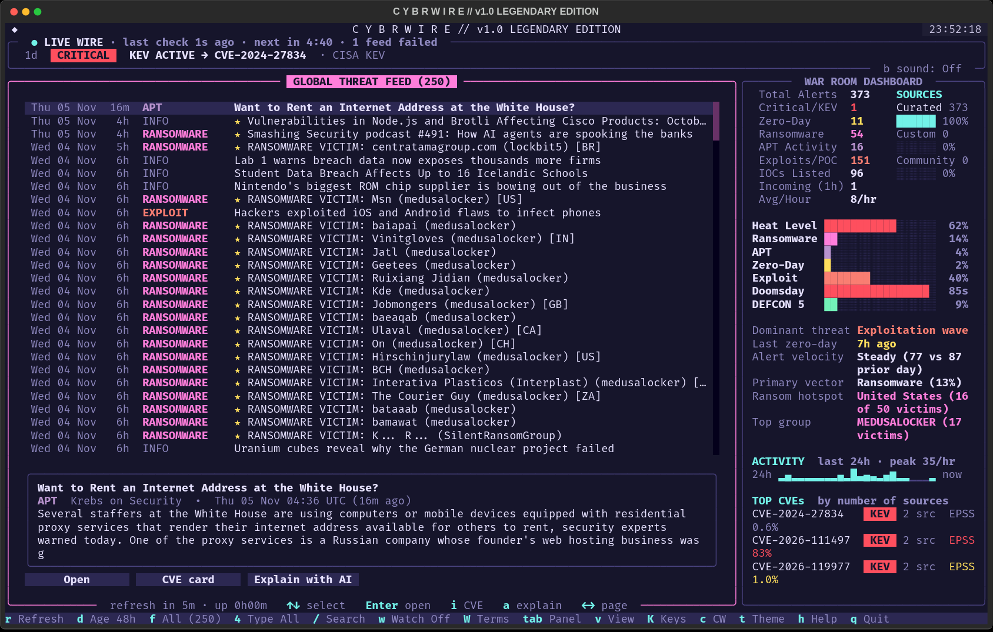

### Search (Amber CRT)
Press `/` to search every loaded feed and a year of history as you type. Search ignores the Data Age window.

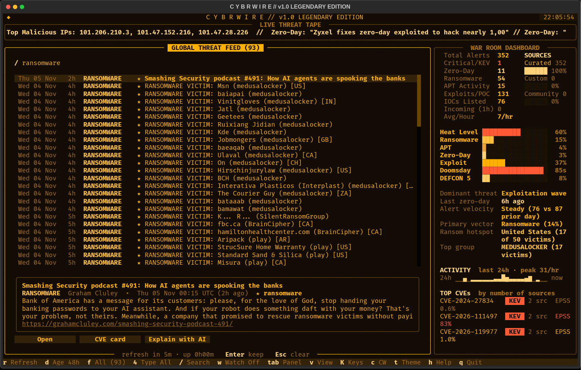

### Watchlist (Retro Warm, Synthwave)
Star the vendors and products you care about, then press `w` to see only those. `Shift+W` lists every term and what it catches.

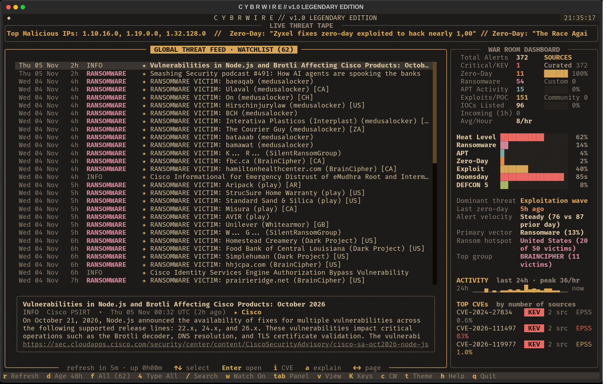

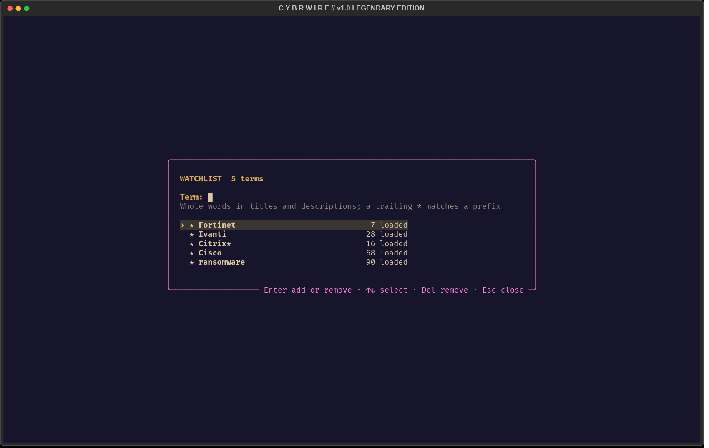

### CVE Card (Amber CRT)
Press `i` on any alert for severity, EPSS, known exploitation, CISA's required action, affected products and references.

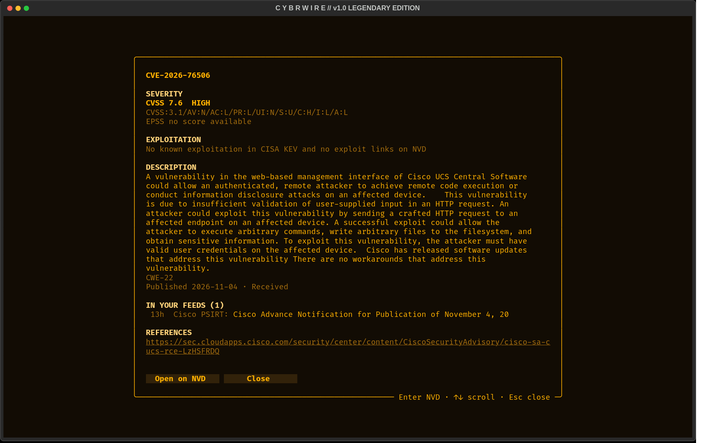

### Grouped Duplicates (Amber CRT)
The same story from several feeds becomes one row marked `+N`. Press `u` to list every report.

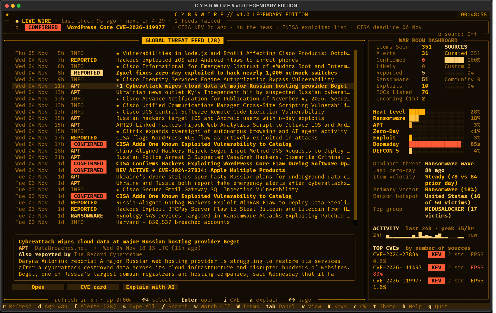

### Live Wire (Retro Warm)
The bar across the top follows each feed check as it runs and announces what's new. Between arrivals, the most severe current items take turns.

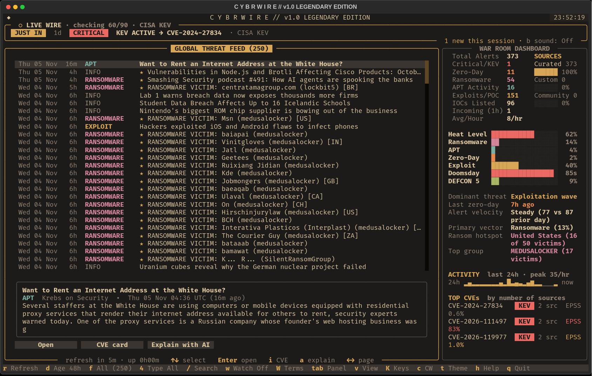

### API Keys (Synthwave)
Press `Shift+K` to enter and test keys. They go to your system keychain and never appear in full.

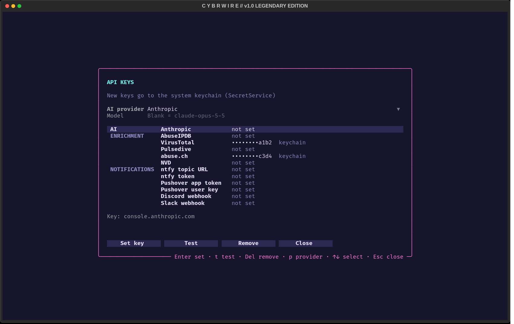

### Indicators (Retro Warm)
Malicious IPs, URLs and C2 servers get their own view. Press `Enter` on one to look it up in API Tools.

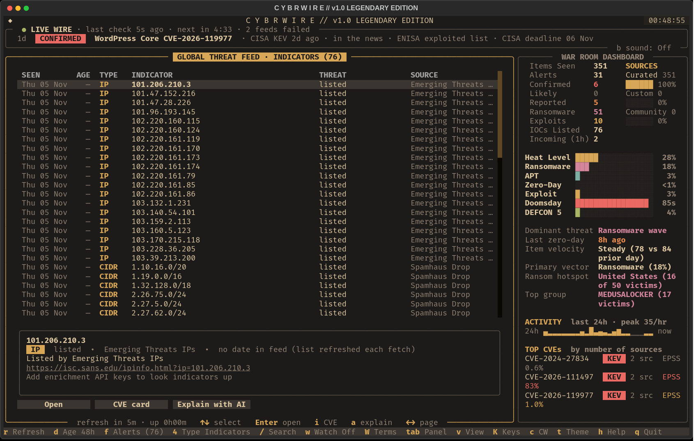

### Incidents and War Room
Alerts correlated into incidents when independent sources report the same CVE, IP, hash or threat actor, next to an AI briefing in the War Room.

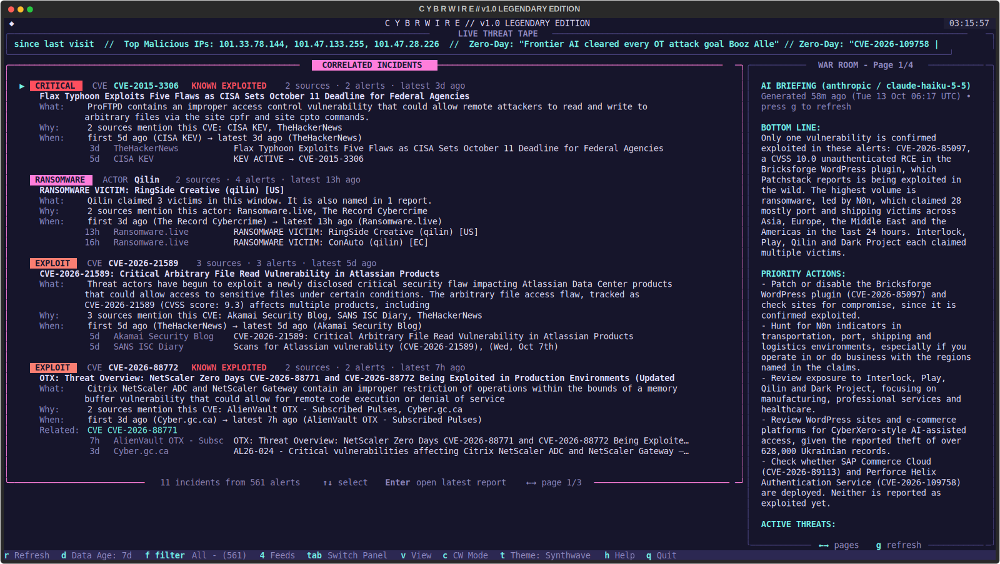

### Cold War Mode
A green phosphor terminal: FLASH / IMMEDIATE / PRIORITY / ROUTINE message precedence, Zulu date-time groups, a classification banner and a teletype cursor. Press `c` to toggle.

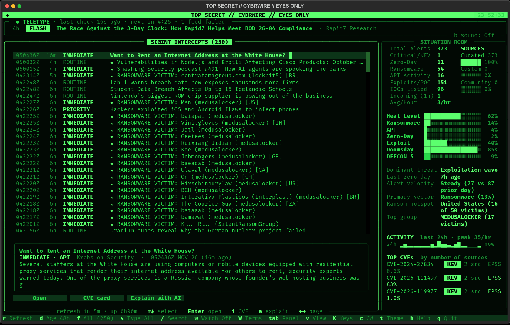

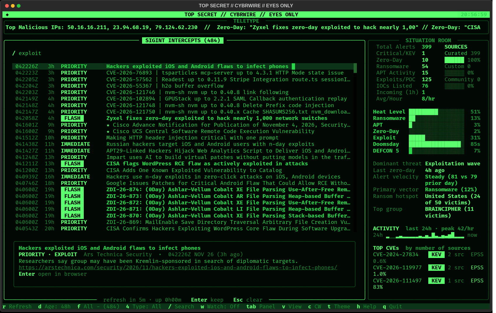

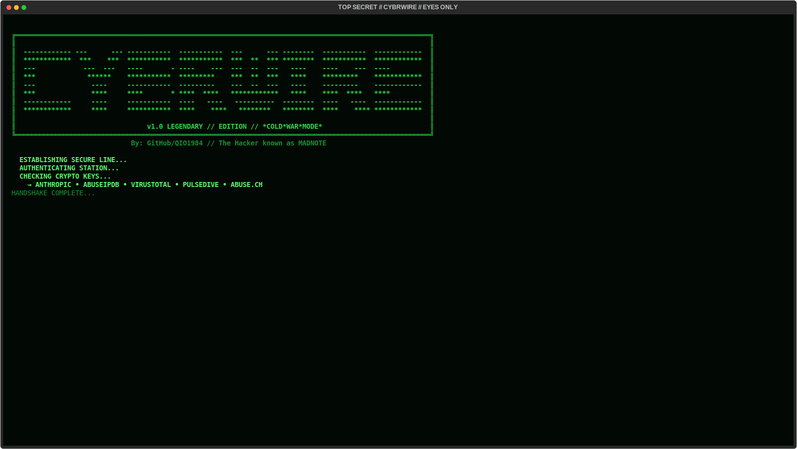

### API Tools
Look up an IP, file hash, domain or URL across every configured enrichment provider.

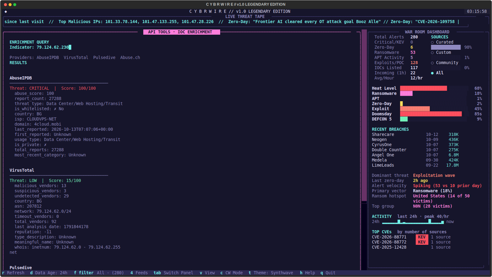

Press `t` to cycle themes. Your choice is remembered between runs. To retake these from live feeds, run `venv/bin/python tools/screenshots.py`.

## Installation & Usage

```bash
# Clone the repo
git clone https://github.com/QIO1984/cybrwire.git
cd cybrwire

# Recommended: create a virtual environment
python3 -m venv venv
source venv/bin/activate

# Install dependencies
pip install -r requirements.txt

# Run it! Press Shift+K in the app to add API keys (optional)
python3 cybrwire.py
```

### Keyboard Controls

| Key | Action |
|-----|--------|
| `h` | Show help screen |
| `r` | Force refresh all feeds |
| `d` | Cycle data age (24h → 48h → 7d) |
| `f` | Cycle filter (all → alerts only → posts only) |
| `4` | Cycle content type (All → Advisories → News & Research → Ransomware → Indicators) |
| `/` | Search all loaded items (`esc` clears) |
| `w` | Show only watchlist hits, or everything |
| `W` | Open the watchlist card: see all terms and their hits, add or remove them |
| `u` | Group duplicate reports, or list them all |
| `i` | Open the CVE card for the selected alert or incident |
| `tab` | Switch between main feed and dashboard panels |
| `v` | Cycle main view (alerts → incidents → API tools) |
| `c` | Toggle Cold War Mode |
| `t` | Cycle theme (Synthwave → Retro Warm → Amber CRT) |
| `↑` `↓` / click | Select an alert or incident (click again to open) |
| `enter` | Open the selected alert or incident in your browser |
| `a` | Explain the selected alert with AI |
| `g` | Generate a fresh AI briefing (War Room) |
| `e` | Re-enable disabled feeds |
| `q` | Quit |

Your data age, display mode, theme and filters are saved in `cybrwire_state.json`, so later launches skip the startup questions. Run `python3 cybrwire.py --setup` to answer them again.

## AI Briefings

The War Room panel (`tab`, then `v`, or just press `g`) shows a briefing written by the AI provider you choose: bottom line, priority actions, active threats, notable vulnerabilities, and a watch list, based on the alerts in your current data window. Press `a` on any alert for a short explanation of it.

Press `Shift+K` to choose a provider and model, then add its key. AI stays off until all of them are set, because there is no default model: you choose what you pay for. OpenAI-compatible servers also need a URL. Ollama runs models on your own machine, so no alert data leaves it.

You can keep a Primary and an Alternate provider and model, and switch between them in the card with `a` or a click. Each provider keeps its own key, so switching never sends one provider's key to another.

## Live Wire

The bar across the top shows what the app is really doing. Its title follows each feed check as it runs, then counts down to the next one. Between arrivals, what has the strongest evidence of exploitation in the last 7 days takes turns, along with busy ransomware campaigns and new breaches, and each line says why it's there. New items with evidence, or watchlist hits, are announced as `JUST IN`. Anything new wears a `LIVE` badge in the feed for 90 seconds. Press `l` or click the bar to jump to what's on show.

## Evidence

Keywords can't tell you whether something is being attacked, so stories are judged on outside signals:

| Label | Means |
|---|---|
| `CONFIRMED` | On an official exploited list: CISA KEV or ENISA EUVD. New entries show what to do, with CISA's deadline where it still applies |
| `LIKELY` | A high EPSS exploit-likelihood score, or public exploit code plus a raised score |
| `REPORTED` | News headlines or a CIRCL sighting say it's exploited, without official confirmation |

The default **Alerts** filter (`f`) shows those, plus watchlist hits, new breaches, threat-actor stories and ransomware stories. Press `f` for everything. Search and the content types (`4`) look past it, and individual ransomware claims live under `4`. The same evidence decides the dashboard counts, sounds and notifications.

Exploitation and public-exploit sightings come from [CIRCL's Vulnerability-Lookup](https://vulnerability.circl.lu), a free public service run by the Computer Incident Response Center Luxembourg. Thank you to CIRCL for running it. CybrWire asks for recent sightings only, once an hour.

Feeds are checked every 5 minutes, so an alert can't appear sooner than its source publishes it and the next check finds it.

Press `b` to choose an alert sound: off (the default), PC speaker, teletype bell, modem chirp or your terminal's bell. Each plays when you choose it. It sounds at most once per check, for something newly confirmed, a reported zero-day or a watchlist hit. Without an audio player, as over SSH, the terminal bell is used instead.

## Keyboard or Mouse

Everything for reading and moving around works both ways, so you only need the keyboard to type a search or a key.

| Do this | Keyboard | Mouse |
|---|---|---|
| Choose a panel | `Tab` | Click it |
| Next view in that panel | `v` | Right-click it |
| Move through a list | `↑` `↓` `←` `→` | Wheel, or drag the scrollbar |
| Open a row | `Enter` | Click the selected row, or the Open button |
| Turn War Room and Feed Status pages | `←` `→` | Wheel, or Prev and Next under the panel |
| Commands in the footer | Their keys | Click them |
| Go to the alert on the Live Wire | `l` | Click the bar |

Some terminals keep right-click for their own menu. If yours does, look for a setting that passes it to the application.

## API Keys

Press `Shift+K` to enter, test and remove API keys, notification targets and feed keys. Each key is tested when you enter it and takes effect straight away. Everything in the card works by keyboard or mouse.

| Stored in | When | Protection |
|---|---|---|
| Environment variable | You set `CYBRWIRE_NVD_API_KEY` and the like, or `CYBRWIRE_NVD_API_KEY_FILE` for a mounted secret. Wins over everything else | Up to your environment |
| System keychain | The default for new keys | Encrypted at rest by your desktop or OS |
| `cybrwire_secrets.yaml` | Only when no keychain works, and the app warns you | Your user only, **not encrypted** |
| `usrwire.yaml` | Old setups still work, but the app asks you to move them: press `m` in the card | Plaintext |

Variable names are `CYBRWIRE_` plus `ANTHROPIC_API_KEY`, `GEMINI_API_KEY`, `OPENAI_API_KEY`, `OPENROUTER_API_KEY`, `OPENAI_COMPATIBLE_API_KEY`, `ABUSEIPDB_API_KEY`, `VIRUSTOTAL_API_KEY`, `PULSEDIVE_API_KEY`, `ABUSE_CH_API_KEY`, `NVD_API_KEY`, `NTFY_URL`, `NTFY_TOKEN`, `PUSHOVER_TOKEN`, `PUSHOVER_USER`, `TELEGRAM_TOKEN`, `TELEGRAM_CHAT_ID`, `DISCORD_WEBHOOK` or `SLACK_WEBHOOK`. A feed's key uses `FEED_` plus its name, such as `CYBRWIRE_FEED_MY_FEED`. Set `CYBRWIRE_KEYCHAIN=off` to skip the keychain.

A keychain protects keys from other users, backups and accidental commits. It can't stop malware running as you, because the app itself has to be able to read them.

Testing a key makes one call to that provider. AI providers only list models, which is free; AbuseIPDB, VirusTotal and Pulsedive count one lookup against your quota; feeds get one normal request; notification targets receive a real test message.

## API Tier Limitations ⚠️

CybrWire supports multiple threat intelligence providers with optional API key enrichment. **Free and limited API tiers have restrictions on indicator types they can query.**

### VirusTotal
- **Free Tier**: IPs, file hashes, domains, and URLs
  - Rate limit: 4 queries/minute, 500/day quota
- **Paid Tier**: Higher quotas and premium features

### AbuseIPDB
- **Free Tier**: IP reputation lookups only
  - Limited to IP addresses (no hashes, domains, URLs)
- **Paid Tier**: Enhanced features and higher rate limits
- **When to upgrade**: For broader query quotas and advanced scoring

### Pulsedive
- **Free Tier**: Limited indicator database
  - May not have comprehensive hash or malware data
- **Paid Tier**: Full threat intelligence database access
- **When to upgrade**: For comprehensive threat data across all indicator types

### Abuse.ch
- **Free**: MalwareBazaar (hashes) and URLhaus (URLs, IPs, domains)
  - Requires a free Auth-Key from https://auth.abuse.ch/
- **Recommended for**: Hash and malicious URL lookups

### Recommendation

For best results with CybrWire enrichment:
1. **Use Abuse.ch** (free Auth-Key) for hash and URL enrichment
2. **Use AbuseIPDB** for IP reputation (free tier available)
3. **Use VirusTotal** for multi-engine verdicts on any indicator type
4. **Configure multiple providers** for redundancy and broader coverage

A **CLEAN** result means the provider has no record of the indicator, not that it is known to be safe.

## Configuration Files

- **`cybrwire.yaml`** – Curated official threat feeds (CISA, Microsoft, Talos, etc.)
- **`usrwire.yaml`** – Yours: your feeds, watchlist and notification triggers. Created on first run from `usrwire.example.yaml`, ignored by git, and never holds keys
- **`community.yaml`** – Community-contributed feeds - Submit yours via PR

Feeds can be `rss`, `json` (CISA KEV, Ransomware.live, GitHub advisories, and AlienVault OTX formats),
`txt` (IP/CIDR lists, URL lists, DShield), or `threatfox` and `urlhaus` (use your abuse.ch key).
Give each feed a `kind` so it lands in the right group: `advisory`, `news` (the default),
`ransomware`, or `indicators`. If a feed needs an API key, say how it is sent, and the key card gets a row for it:

```yaml
custom:
  - name: "AlienVault OTX - Subscribed Pulses"
    url: "https://otx.alienvault.com/api/v1/pulses/subscribed?limit=10"
    type: json
    key_header: X-OTX-API-KEY   # or key_param: key, for a URL parameter
```

Watchlist terms can be added in the app with `Shift+W` or listed in `usrwire.yaml`.
They match whole words in an alert's title or description, in any case, and a trailing `*`
matches a prefix:

```yaml
watchlist:
  - Fortinet
  - citrix*
  - CVE-2024-3400
```

Notifications can go to ntfy, Pushover, Telegram, Discord or Slack. Targets are added with `Shift+K`, because their URLs work like passwords. Which events
send one is set in a `notifications:` section (see `usrwire.yaml`). Run `python3 cybrwire.py --test-notify` to check them.

Every alert is saved to `cybrwire_history.db` for a year, so search can find items that feeds have dropped.

Errors and feed failures are written to `cybrwire.log` in the app folder, with loaded keys masked.
The app restricts `usrwire.yaml`, `cybrwire_secrets.yaml`, its state, history and log files to your user.

## Features in Detail

### War Room (AI Analysis)
An AI briefing (see [AI Briefings](#ai-briefings)) followed by a local keyword analysis that needs no AI: top CVEs, affected software, exploit maturity, sectors, and threat actors.

### Incident Correlation
An incident is created when independent sources point at the same thing:
- The same **CVE**, **IP address**, or **file hash** reported by two or more different feeds
- A named **threat actor or ransomware group** appearing in two or more alerts

Each incident explains itself: what it is (the CISA KEV description when the CVE is known exploited), why the alerts were grouped, when it was first and last reported and by whom, related incidents, and the latest reports.

### Dashboard
Metrics are computed from the alerts in your data window. The ransomware hotspot and most active group come from Ransomware.live victim posts, item velocity compares the last 24 hours with the 24 hours before, and the Doomsday Clock shows the [Bulletin of the Atomic Scientists](https://thebulletin.org/doomsday-clock/) setting, checked once a day.

### API Tools
Query threat intelligence APIs directly from CybrWire:
- Enter an indicator (IP, hash, domain, or URL)
- Get reputation scores and threat details from all configured providers
- See which APIs support which indicator types

## Requirements

- Python 3.10+
- `rich` – Beautiful terminal output
- `httpx` – Async HTTP client for feed fetching
- `feedparser` – RSS/Atom feed parsing
- `pyyaml` – YAML configuration files
- `textual` – TUI framework
- `anthropic` – Only used when the AI provider is `anthropic`

## License

MIT License - See LICENSE file for details

## Contributing / Feed Crowd-sourcing

Contributions are welcome and much needed! Please feel free to submit pull requests or open issues for bugs and feature requests.

If you have a cool source for intel, please submit it via PR to the community.yaml 
Verified feeds will be added to the canon.

## Author

By: GitHub/QIO1984 // The Hacker known as MADNOTE


---

**Stay vigilant. Stay informed. Stay WIREed**
